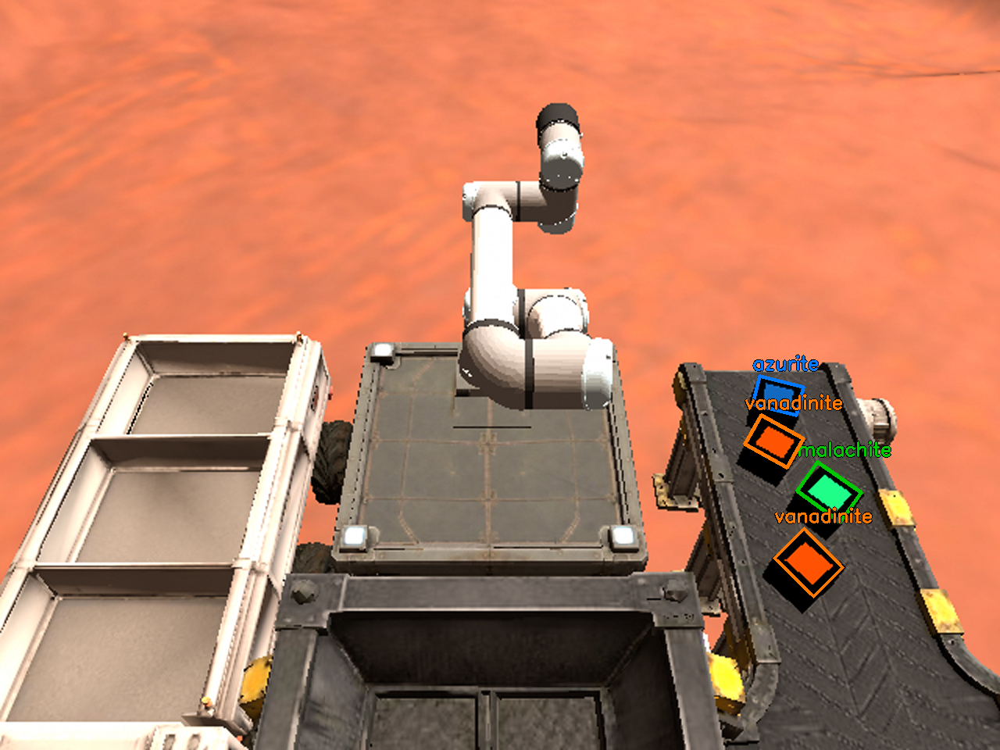
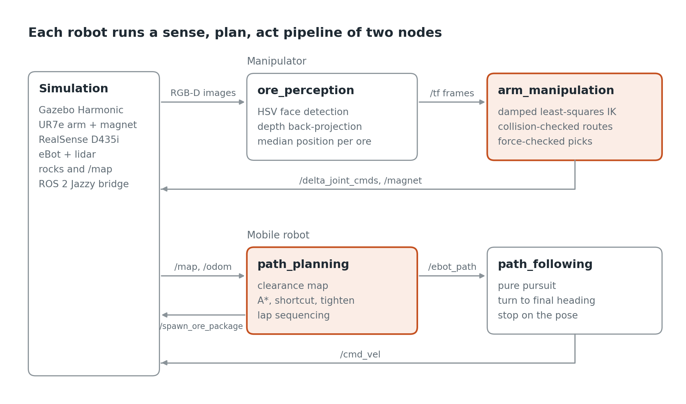
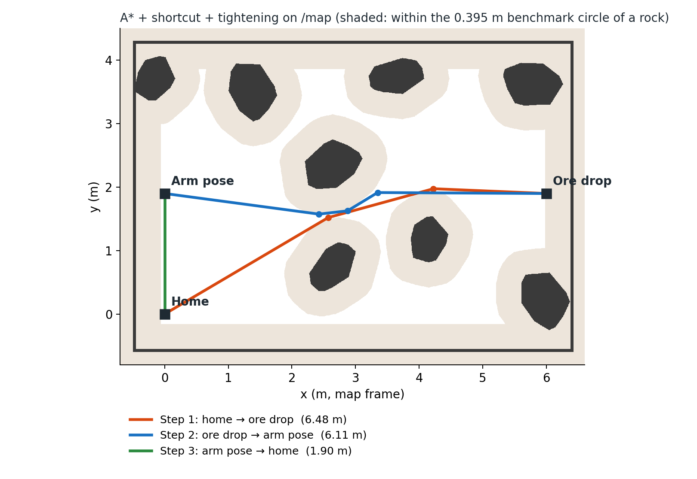
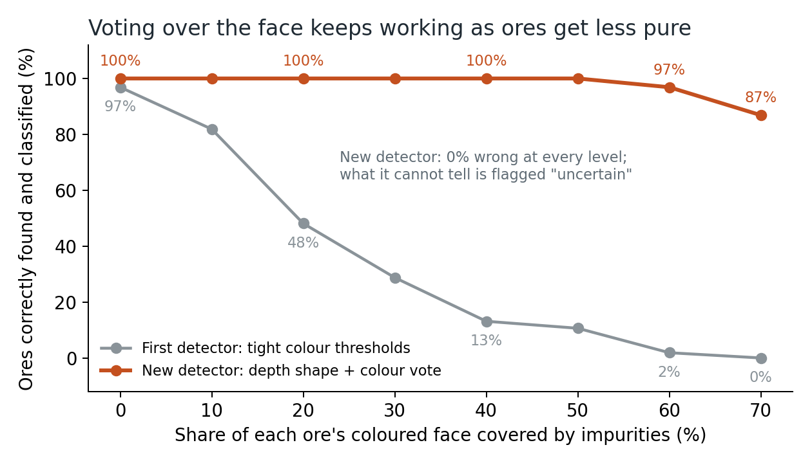

# Strata Cobot: autonomous ore sorting and haulage in ROS 2

A UR7e robot arm and a mobile robot (eBot) sort and haul ore in simulation with no human in the loop. The arm finds ores with an RGB-D camera, picks each with a magnet and drops it in the container for its mineral. The mobile robot plans its own collision-free paths through a field of rocks and drives them.

All perception, inverse kinematics, motion planning and path planning is written from scratch, without MoveIt 2, Nav2 or any other ready-made planner.

Robotics course project, Amrita Vishwa Vidyapeetham, by **C Saihardhik Reddy**, **R Gagan Chowdary** and **K Charan Saatvikh Reddy**.



## Results

Each trial used a freshly launched world with randomised ores or rocks.

| Subsystem | Result |
| --- | --- |
| Ore perception | Every ore located within 2–3 mm of its true position; correct up to 50% impurity, 70% of real held-out mineral photos (11% before) |
| Arm manipulation | 8 of 8 ores sorted into the correct container over two trials, no safety stops |
| Path planning | Paths as short as the reference shortest path (efficiency up to 1.00) |
| Path following | Within 0.09 m of every path, no collisions |

## How it works

| Node | Role |
| --- | --- |
| `ore_perception.py` | Finds each ore by shape in the depth image, classifies its mineral by a vote over the colours of its whole face (real ores are rarely one colour), publishes tf2 frames |
| `arm_manipulation.py` | Damped least-squares IK with the tool vertical, collision-checked joint-space routes, straight vertical descents by resolved-rate control, force-confirmed magnet picks |
| `path_planning.py` | Clearance map from `/map`, A* on a 5 cm grid, shortcutting and corner tightening, clearance chosen so the path matches the shortest length |
| `path_following.py` | Pure-pursuit path following, turn to the final heading, stop on the pose |





The full write-up is the IEEE-format report, [`docs/Strata_Cobot_IEEE_Report.pdf`](docs/Strata_Cobot_IEEE_Report.pdf) (LaTeX source in [`report/`](report/)). The slides are [`docs/Strata_Cobot_Presentation.pptx`](docs/Strata_Cobot_Presentation.pptx).

## Impure ores

Real ores are rarely one clean colour: veins of other minerals, dark or brown matrix, dust and lighting all get in the way. The perception node therefore separates *where* an ore is (its height above the belt in the depth image) from *what* it is (the share of its face in each mineral's colour, with "uncertain" when no colour clearly wins).



| Held-out real photos (Wikimedia Commons) | First detector | Colour vote |
| --- | --- | --- |
| Azurite | 10% | 37% |
| Malachite | 7% | 80% |
| Vanadinite | 17% | 93% |
| **All 90** | **11%** | **70%** |

Reproduce with the scripts in [`experiments/`](experiments/) (ROS 2 sourced):

```bash
python3 experiments/impurity_robustness.py     # painted impurities on a captured camera frame
python3 experiments/fetch_commons_photos.py    # 180 real photos + licence manifest
python3 experiments/calibrate_colour.py        # tune on 90 photos, test on the other 90
python3 experiments/real_mineral_photos.py     # first detector vs colour vote
```

## Running it

Requirements: Ubuntu 24.04, ROS 2 Jazzy, Gazebo Harmonic, and the e-Yantra Strata Cobot simulation packages (`eyantra_kepler_colony`, `ur_description`, `ebot_description`) in `~/ros2_ws/src`.

1. Copy `src/strata_cobot` into `~/ros2_ws/src/` and build:

   ```bash
   cd ~/ros2_ws && colcon build --packages-select strata_cobot && source install/setup.bash
   ```

2. Ore sorting, in three terminals (start the nodes once the world reports it is ready):

   ```bash
   ros2 launch eyantra_kepler_colony task2a.launch.py
   ros2 run strata_cobot ore_perception.py
   ros2 run strata_cobot arm_manipulation.py
   ```

3. Mobile robot lap, in three terminals:

   ```bash
   ros2 launch eyantra_kepler_colony task2b.launch.py
   ros2 run strata_cobot path_planning.py
   ros2 run strata_cobot path_following.py
   ```

## Repository layout

```
src/strata_cobot/   ROS 2 package with the four nodes
experiments/        perception experiments: impurities, real mineral photos, calibration
docs/               report PDF, slides (and the script that builds them), figures
report/             IEEE LaTeX source of the report (IEEEtran)
```

## Acknowledgement

The simulated world, robots and sensors are from the [e-Yantra](https://portal.e-yantra.org/) Strata Cobot environment, IIT Bombay.
